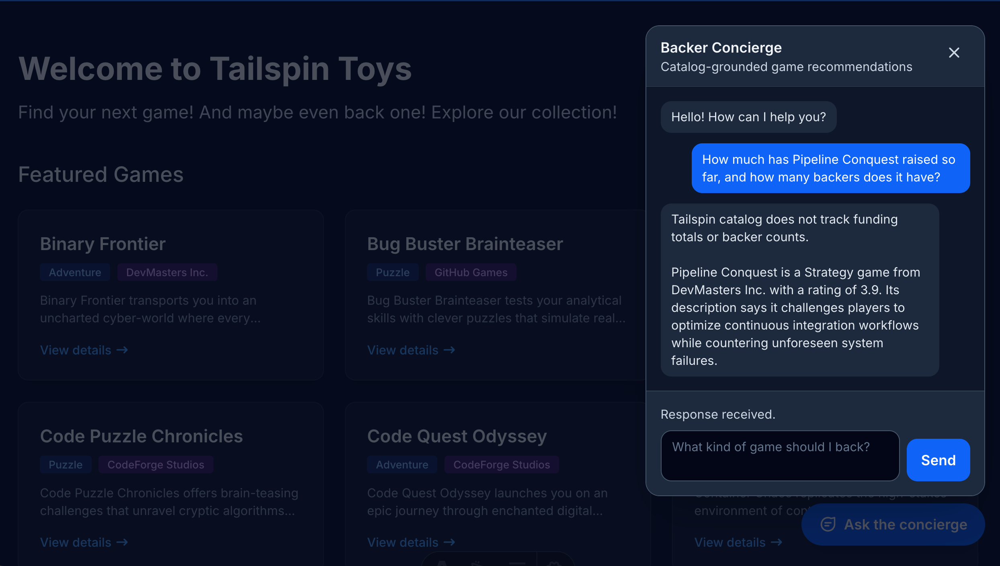

No [Módulo 2][previous-lesson], você implantou e testou o Backer Concierge. Este último módulo da [série opcional do concierge][overview] disponibiliza esse agente no site local do Tailspin Toys.

Neste módulo, você vai:

- criar um proxy local do Azure Functions que mantém as credenciais do Foundry no servidor.
- adicionar um widget de chat acessível ao site.
- verificar o fluxo completo da conversa e limpar seus recursos.

## Cenário

Os apoiadores descobrem jogos no site do Tailspin Toys, não no terminal de desenvolvimento ou em um portal do Azure. A equipe quer disponibilizar o concierge junto ao catálogo, com uma experiência de chat que permita perguntas de acompanhamento e proteja as credenciais do serviço.

## Continue com seu agente hospedado

A integração com o site precisa do agente implantado no Módulo 2. Você manterá esse agente em execução no Foundry enquanto o proxy e o site são executados localmente.

1. Volte ao repositório do Tailspin Toys na branch `foundry-agent-cli` e à sessão existente do Copilot CLI.
2. Confirme que o Backer Concierge está implantado e que a invocação remota de [Crie e implante o agente][previous-lesson] foi bem-sucedida. Se você já removeu os recursos do Azure, recrie-os seguindo os módulos anteriores antes de continuar.

> [!IMPORTANT]
> O proxy e o site deste módulo são executados localmente; esta não é uma implantação do site em produção. O modelo e o agente hospedado continuam sendo recursos do Azure que geram custos até que você conclua a [limpeza][cleanup].

## Crie o proxy do lado do servidor

O Tailspin Toys é totalmente pré-renderizado. O código do navegador nunca deve chamar o agente hospedado diretamente nem receber credenciais do Foundry. Você adicionará uma **barreira de proteção de credenciais do lado do servidor** com o Azure Functions local, que se autentica no Foundry e retorna ao navegador apenas a resposta do agente.

A skill `microsoft-foundry` é responsável pelo fluxo de trabalho do agente hospedado, enquanto as skills mais abrangentes do Azure no mesmo plugin podem preparar o projeto local da Function. Você usará essas skills para criar o proxy e verificará se ele acessa o agente sem expor credenciais.

1. No Copilot CLI, insira:

    ```text
    Use as skills do Azure para adicionar em `api` um projeto Azure Functions v4 com Node.js e TypeScript, contendo um endpoint POST `/api/concierge` que invoque meu agente hospedado Backer Concierge implantado. Esta Function será executada somente localmente; não a adicione a `azure.yaml` nem crie infraestrutura de implantação do Azure. Use `DefaultAzureCredential` com meu login local do Azure. Mantenha simples o gatilho HTTP, isole o cliente do Foundry em um módulo testável por testes de unidade, valide e limite os corpos das solicitações, defina tempos limite explícitos e retorne erros sanitizados. Armazene o endpoint do projeto do Foundry e o nome do agente em configurações locais do servidor excluídas do controle de versão. Nunca retorne credenciais nem tokens de acesso ao navegador. O site Astro usa `output: 'static'` e não tem proxy de desenvolvimento; portanto, adicione também em `astro.config.mjs` um proxy local exclusivo para o servidor de desenvolvimento Vite, encaminhando `/api` à porta da Function, para que solicitações relativas a `/api/concierge` cheguem até ela durante `astro dev`.

    For conversation state, generate a high-entropy handle on the server, map it to the Foundry conversation server-side with an expiration, and never expose a raw Foundry conversation or thread identifier. Reject malformed, expired, and unknown handles. Add focused unit tests.
    ```

    

2. Abra outro terminal e inicie a Function local usando o comando fornecido pelo Copilot. Deixe a Function em execução.
3. Volte ao Copilot CLI e peça ao Copilot para testar o proxy local:

    ```text
    Send a request to the local /api/concierge endpoint asking "Which games are under $30?" and show me the sanitized JSON response. Confirm that the request reaches the deployed Backer Concierge through DefaultAzureCredential.
    ```

4. Inspecione a resposta. Ela deve explicar que o catálogo não contém preços. Não pode conter um token do Foundry, uma credencial, um endpoint de projeto, um identificador bruto de conversa do Foundry ou um rastreamento de pilha.

    

## Crie o widget de chat

O proxy oferece ao navegador uma forma segura de acessar o concierge. Agora, você adicionará um widget de chat ao site e usará o Playwright para verificar o fluxo completo da conversa.

1. Peça ao Copilot para criar a integração com o site:

    ```text
    Adicione um widget de chat acessível do Backer Concierge como componente Astro e renderize-o em todo o site a partir de `Layout.astro`. Ele deve enviar uma solicitação POST para `/api/concierge` e manter a conversa usando o identificador opaco retornado, seguir o tema escuro de `style.instructions.md`, permitir fechar com Escape e incluir atributos `data-testid`.
    ```

2. Mantenha a Function local em execução e inicie o site Astro em outro terminal usando o comando fornecido pelo Copilot.
3. Volte ao Copilot CLI. O servidor MCP do Playwright que você adicionou na [Lição 4][playwright-lesson] já está disponível. Peça ao Copilot para testar o widget:

    ```text
    Use o servidor MCP do Playwright para testar de ponta a ponta o widget Backer Concierge no site Tailspin Toys em execução. Verifique o fluxo principal do chat, a continuidade da conversa, a acessibilidade, o tratamento de erros, os limites das fontes usadas para fundamentar as respostas e o uso seguro do proxy local. Informe os resultados e inclua evidências de eventuais falhas.
    ```

    

4. Revise os resultados com base nas evidências apresentadas. Se alguma verificação falhar, peça ao Copilot para corrigir o comportamento correspondente do proxy ou do widget e executar novamente as verificações que falharam antes de concluir.

## Limpe seus recursos

Você chegou ao resultado final: um concierge funcional no site local. As instruções de limpeza compartilhadas cobrem tanto os serviços locais quanto os recursos do Azure criados ao longo da série.

1. Conclua [Limpe seus recursos][cleanup], incluindo parar os serviços locais e verificar se a exclusão dos recursos do Azure foi concluída.

## Resumo e próximos passos

Você conectou o Backer Concierge hospedado ao Tailspin Toys por meio de um proxy local do lado do servidor e um widget de chat acessível. Ao longo da série, usou o GitHub Copilot CLI e o Foundry para preparar um modelo, criar e implantar um agente e verificar uma integração completa com o site.

Continue em [Revisão e próximos passos][review] para encerrar o workshop da CLI.

[overview]: ../
[previous-lesson]: ../2-build-and-deploy/
[review]: ../../10-review/
[playwright-lesson]: ../../6-mcp-playwright/
[cleanup]: ../#limpe-seus-recursos
